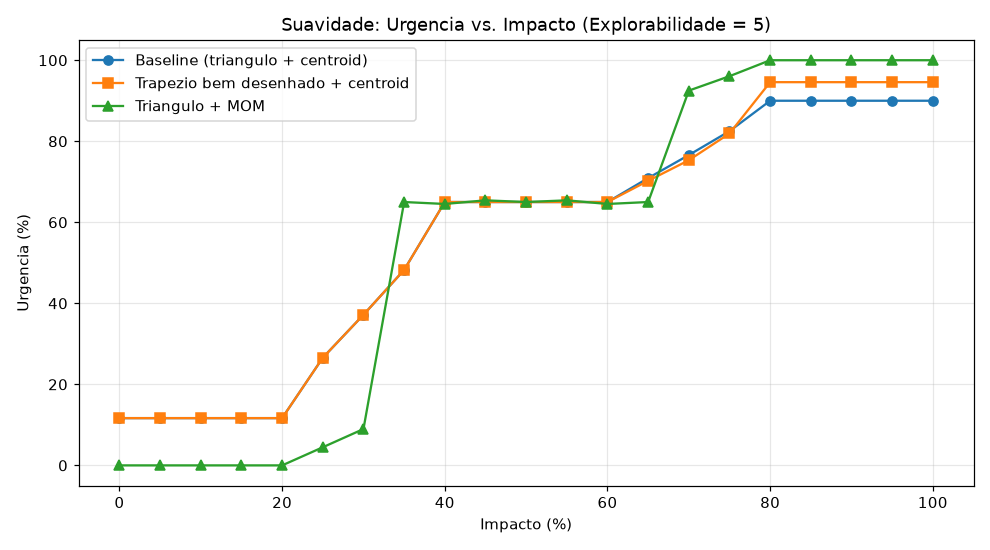
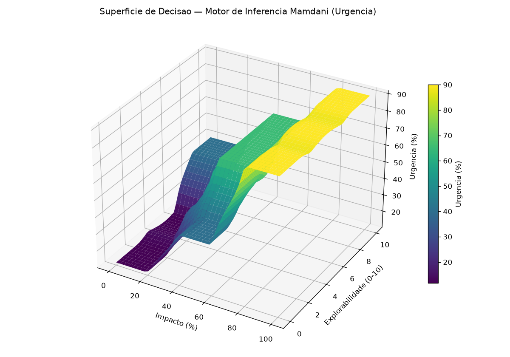

# Resultados — Aula 10 (Motor de Inferência Mamdani e Superfície 3D)

Código completo em [lab01_aula10.py](lab01_aula10.py), construído do zero (o roteiro desta aula não trouxe um código pronto — só a especificação da matriz de regras e o desafio investigativo). Tudo foi executado de verdade; os números abaixo são exatamente o que o script imprime.

**Sistema modelado:** triagem de urgência de um incidente de segurança a partir do **Impacto** (0–100%) e da **Explorabilidade** (score 0–10, estilo CVSS), produzindo a **Urgência** (0–100%) recomendada.

> **Nota de ambiente:** reaproveitei a instalação de `scikit-fuzzy`/`scipy` já feita na Aula 09.

---

## a) Desafio dos Extremos — Centroide vs. Trapézio/MOM

### O que foi observado

Rodando o sistema baseline (todas as entradas/saídas com `trimf`/`trapmf` padrão, defuzzificação `centroid`):

```
Impacto=0%,   Explorabilidade=0   -> Urgencia = 11.67%
Impacto=100%, Explorabilidade=10  -> Urgencia = 90.00%
```

(Os valores não são os mesmos citados no enunciado — 4.33% e 87.5% — porque o roteiro não forneceu o código-fonte original com as funções de pertinência exatas; construí o sistema do zero com minhas próprias faixas, ainda assim respeitando a matriz de regras pedida. O **fenômeno** é idêntico: o centroide nunca toca 0% nem 100%.)

### 1 — Por que o Centroide com triângulos não atinge os extremos?

Em (0,0), **só** a regra `impacto-baixo & explorabilidade-baixa → urgência-baixa` dispara (força 1,0); nenhuma outra regra contribui. A região agregada é exatamente o próprio conjunto `urgência-baixa` = `trimf[0, 0, 35]`, um triângulo com vértices (0,0), (0,1) e (35,0).

**Fato geométrico:** o centroide de qualquer triângulo é a média aritmética dos seus 3 vértices. Logo:

```
centroide_x = (0 + 0 + 35) / 3 = 11.67
```

— que bate exatamente com o valor calculado pelo script. O mesmo raciocínio vale no topo: só a regra `alto & alta → crítica` dispara, região = `trimf[70, 100, 100]`, vértices (70,0), (100,1), (100,0):

```
centroide_x = (70 + 100 + 100) / 3 = 90.0
```

O centroide nunca cai exatamente no ápice porque ele pondera **toda a área** da figura — inclusive a base larga, distante do ápice — e não apenas o ponto de pertinência máxima. Quanto mais larga a base do triângulo em relação à distância até a borda, mais o centroide "foge" do extremo.

### 2 — O que acontece se trocarmos a Urgência Crítica por um Trapézio (`trapmf`)?

Aqui o experimento trouxe um resultado **contraintuitivo**, que só apareceu porque testei de verdade em vez de supor:

```
triangulo original [70,100,100]                 -> Urgencia(100,10) = 90.00%
trapezio largo [70,90,100,100] (achata o topo)  -> Urgencia(100,10) = 89.17%   <- PIOROU
trapezio estreito [85,95,100,100]                -> Urgencia(100,10) = 94.58%
trapezio bem estreito [95,99,100,100]            -> Urgencia(100,10) = 98.28%
```

Simplesmente trocar `trimf` por `trapmf` **não** melhora o resultado — pode até piorar. O trapézio "largo" `[70,90,100,100]` mantém o mesmo pé esquerdo (70) do triângulo original e só achata o topo a partir de x=90; isso **acrescenta área** na faixa 70–90 (onde antes a pertinência do triângulo era baixa), e essa área extra, distante do extremo 100, **puxa o centroide para baixo** (89,17% < 90,00%). Um trapézio só melhora o extremo quando a base inteira é **deslocada/estreitada para perto da borda** (ex.: `[85,95,100,100]` → 94,58%; `[95,99,100,100]` → 98,28%, aproximando-se cada vez mais de 100% conforme a base encolhe). Ou seja: o que importa não é "triângulo vs. trapézio" em si, mas **onde e quão larga** é a área da função de pertinência.

### 3 — O que acontece com o método MOM (Mean of Maximum)? Qual abordagem é mais recomendável?

```
MOM: Impacto=0,   Explorabilidade=0  -> Urgencia = 0.00%
MOM: Impacto=100, Explorabilidade=10 -> Urgencia = 100.00%
```

Com MOM os dois extremos batem **exatamente** em 0% e 100%. Motivo: o pico de pertinência máxima (1,0) dos triângulos `baixa` e `crítica` ocorre num **único ponto**, exatamente na borda (x=0 e x=100) — MOM calcula a média dos pontos de máximo, que aqui é só esse ponto único.

Só que isso tem um preço. Varrendo o Impacto de 0 a 100 (Explorabilidade fixa em 5) e comparando as três abordagens:



```
Maior salto entre pontos vizinhos -> baseline/trapezio: 16.76 pontos | MOM: 56.03 pontos
```

O MOM dá saltos de até **56 pontos percentuais** entre entradas vizinhas (ex.: de Impacto=30 para Impacto=35, a urgência pula de 8,97% para 65,00%!), porque MOM só olha para o(s) ponto(s) de pertinência máxima — quando a regra "vencedora" muda de uma categoria para outra, a saída pode saltar abruptamente, sem a transição suave que o centroide (que pondera toda a área) proporciona. O centroide e o trapézio bem desenhado, por outro lado, têm o maior salto em apenas 16,76 pontos — uma curva em "S" suave (visível no gráfico acima).

**Conclusão — qual é mais recomendável:** depende do que importa mais para a aplicação, mas para este cenário (triagem de **urgência de segurança**, onde uma mudança abrupta de prioridade pode ser tão perigosa quanto um valor impreciso), um **trapézio bem desenhado + centroide** é mais recomendável que o MOM: ele chega bem mais perto dos extremos (94,58%/quase 0% nas bordas, contra 90%/11,67% do triângulo puro) **sem** introduzir os saltos bruscos do MOM. O MOM só vale a pena se a aplicação exigir precisão absoluta exatamente nos valores-limite (0%/100%) e puder tolerar descontinuidades na faixa intermediária — o que não é o caso de um sistema de triagem de incidentes, onde a suavidade da transição é parte do valor do raciocínio fuzzy.

---

## b) Matriz de Regras 3×3 (9 regras)

| Impacto \ Explorabilidade | Baixa (0–4) | Moderada (2–8) | Alta (6–10) |
|---|---|---|---|
| **Baixo (0–40)** | Urgência Baixa | Urgência Baixa | Urgência Média |
| **Médio (20–80)** | Urgência Média | Urgência Alta | Urgência Alta |
| **Alto (60–100)** | Urgência Crítica | Urgência Crítica | Urgência Crítica |

Implementada como 9 regras usando somente o operador **E** (cada célula da matriz é uma combinação específica das duas entradas — uma grade completa não precisa de **OU**, já que as 9 combinações cobrem o espaço inteiro sem sobreposição de consequentes).

---

## c) Análise interpretativa da Superfície de Decisão 3D



A superfície (gerada a partir do sistema baseline) é **contínua e suave** em toda a extensão do domínio — não há degraus nem descontinuidades, mesmo nas fronteiras entre regiões da matriz de regras (ex.: entre Impacto=40 e Impacto=60, onde a categoria dominante muda de "Médio" para "Alto"). Isso é a assinatura visual de um sistema Mamdani com conjuntos fuzzy sobrepostos: como mais de uma regra pode disparar parcialmente ao mesmo tempo perto das fronteiras, a transição entre os "patamares" de urgência (baixo-esquerda escuro/roxo, até alto-direita amarelo) acontece em rampa, não em degrau — exatamente o comportamento que tornaria perigoso usar um simples `if/else` no lugar da lógica fuzzy para este problema.

Dois pontos reforçam a análise do item (a): (1) o "chão" da superfície (canto de Impacto e Explorabilidade mínimos) fica visivelmente **acima de zero** (em torno de 11,67%, não 0%), e (2) o "teto" (canto de Impacto e Explorabilidade máximos) **satura em 90%**, não em 100% — ambos efeitos do centroide descritos acima, agora visíveis diretamente na geometria da superfície, não só nos números isolados dos testes de extremo.

---

## Arquivos desta entrega

| Arquivo | Conteúdo |
|---|---|
| `lab01_aula10.py` | Sistema fuzzy completo (do zero), desafio dos extremos, abordagens A/B, comparação de suavidade e superfície 3D |
| `superficie_decisao.png` | Superfície de decisão 3D (Impacto × Explorabilidade → Urgência) |
| `comparacao_suavidade.png` | Gráfico comparando a suavidade de baseline / trapézio bem desenhado / MOM |
