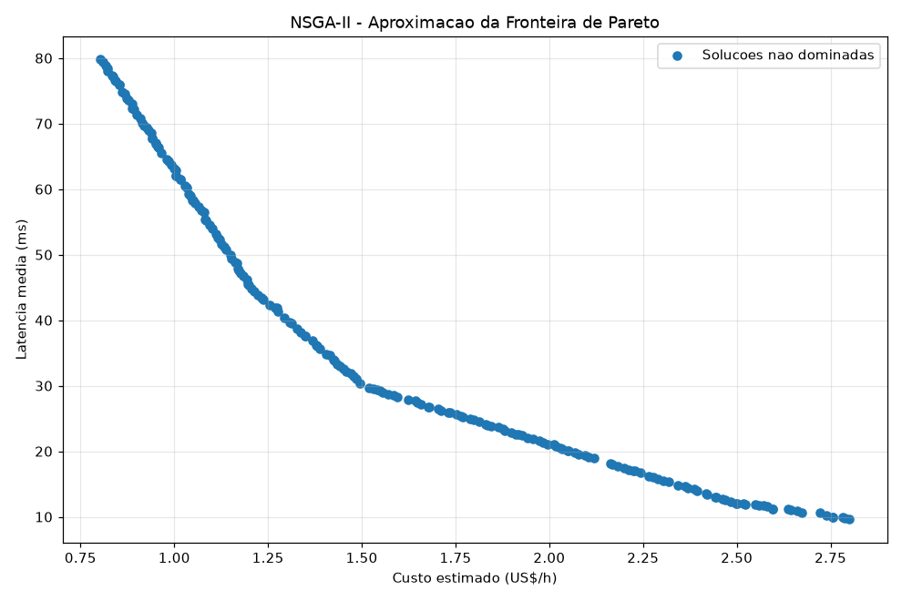
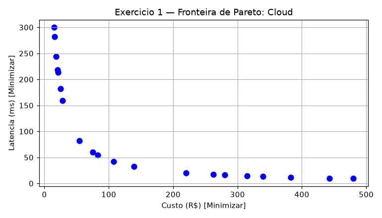
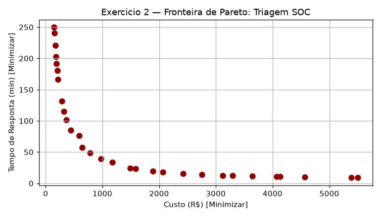
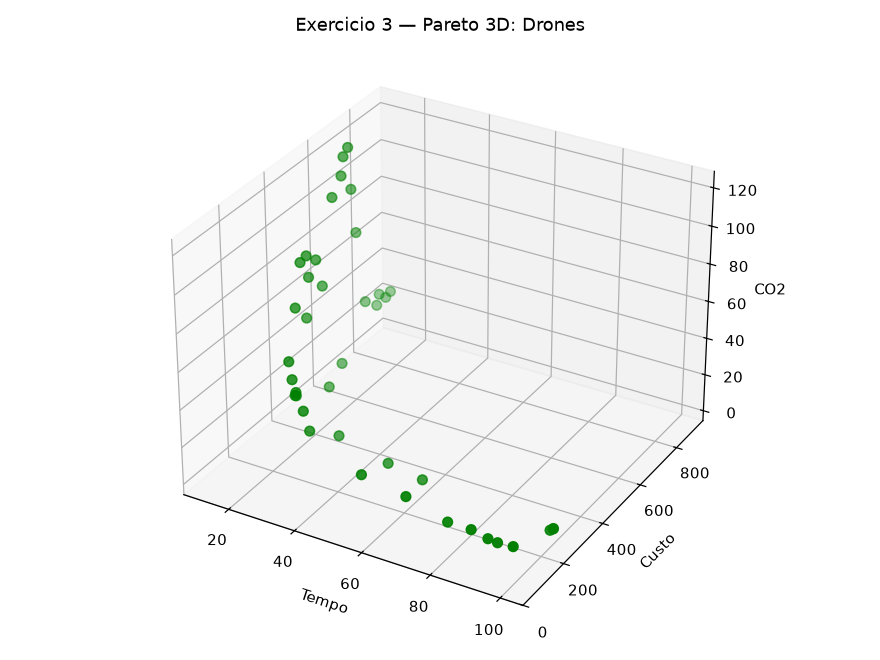
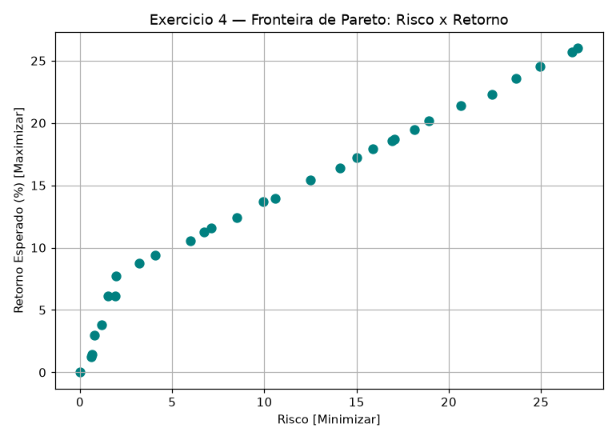
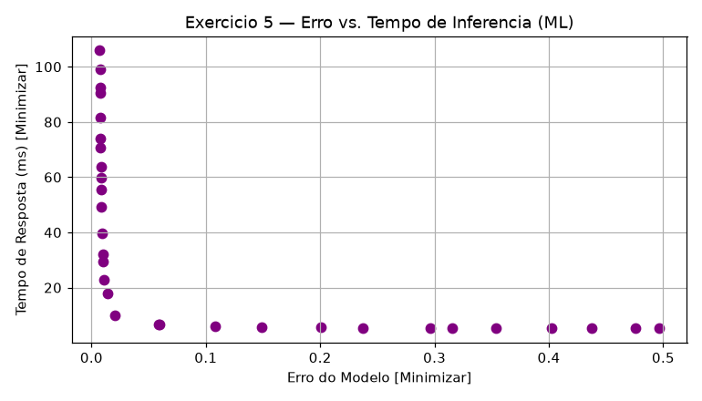
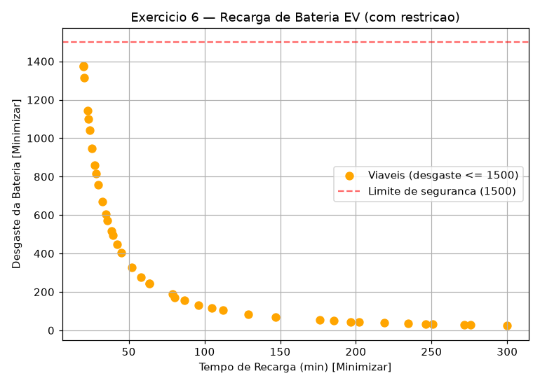
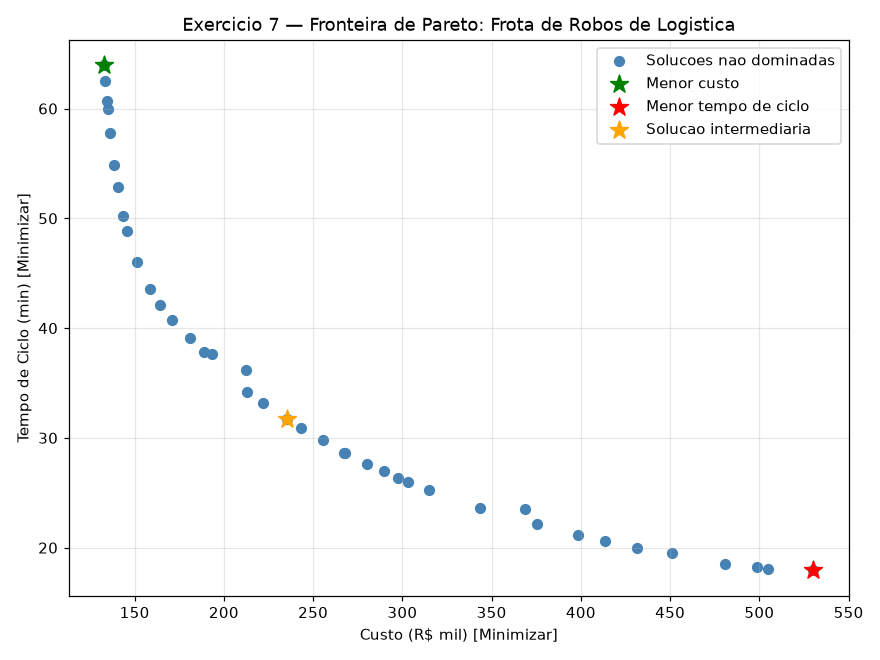

# Resultados — Aula 12 (Otimização Multiobjetivo e NSGA-II)

Sprint 1 da AC-4. Todos os códigos foram executados de verdade com `pymoo` — nenhuma saída abaixo foi inventada.

> **Nota de ambiente:** instalei `pymoo` (e `matplotlib`, já presente de aulas anteriores) para esta atividade.

---

## Demonstração da aula (bônus) — Distribuição de carga em 5 servidores

Não faz parte dos 7 exercícios do laboratório, mas é o exemplo usado na teoria (`demo_aula12.txt`) para introduzir o NSGA-II — rodei para fundamentar as respostas das perguntas de interpretação pedidas no material. Código em [demo_nsga2.py](demo_nsga2.py).

```
RESULTADOS DA OTIMIZACAO NSGA-II
Solucoes nao dominadas: 200

Solucao 1 (menor custo)
Distribuicao: [ 0.5  0.  99.5  0.   0. ]
Custo: US$ 0.80/h
Latencia: 79.80 ms
```



### Perguntas de interpretação

**1. Qual configuração apresenta o menor custo?**
Quase 100% da carga no Servidor 3 (o mais barato: R$ 0,80/h). O algoritmo encontrou `[0.5, 0, 99.5, 0, 0]` — custo US$ 0,80/h, latência 79,80 ms — batendo quase exatamente com o extremo teórico do material (100% no servidor 3, custo 0,80, latência 80 ms).

**2. Qual configuração apresenta a menor latência?**
Verifiquei o outro extremo do resultado real (não só o teórico): o algoritmo encontrou `[0, 39.8, 0, 60.2, 0]` — uma mistura de 40% no servidor 2 e 60% no servidor 4 — com custo US$ 2,80/h e latência 9,61 ms. Isso é interessante: o extremo teórico do material é "100% no servidor 4" (custo 3,00, latência 8 ms), mas o NSGA-II encontrou um ponto que é **mais barato** (2,80 < 3,00) trocando uma latência ligeiramente maior (9,61 ms em vez de 8 ms) — ou seja, uma solução não-dominada que é tão boa quanto ou melhor que o extremo "puro", só não é exatamente o ponto extremo teórico. Isso confirma o aviso do próprio material: "a execução do algoritmo encontra uma aproximação da fronteira, não necessariamente todos os pontos extremos".

**3. Por que a solução de menor custo não é necessariamente a melhor para a empresa?**
Porque "melhor" depende da prioridade do negócio, não só do custo. A solução de menor custo (quase 80 ms de latência) pode deixar o sistema lento demais para milhares de usuários simultâneos — uma aplicação sensível a tempo de resposta pagaria esse preço em experiência do usuário ou até em perda de clientes, o que pode custar mais caro no longo prazo do que economizar R$ 2/hora em infraestrutura.

**4. O que representa cada ponto apresentado no gráfico?**
Cada ponto é uma solução não dominada — uma distribuição específica de carga entre os 5 servidores — que o NSGA-II encontrou e que não é pior que nenhuma outra solução encontrada em **ambos** os objetivos simultaneamente. Juntos, os pontos formam a aproximação da Fronteira de Pareto: o conjunto de melhores compromissos possíveis entre custo e latência.

**5. Por que o NSGA-II retorna várias soluções em vez de apenas uma?**
Porque não existe uma única resposta "correta" quando os objetivos competem entre si (reduzir custo tende a aumentar latência e vice-versa). Em vez de impor um peso arbitrário entre os dois objetivos e devolver uma única resposta, o NSGA-II devolve o leque de alternativas eficientes, e quem toma a decisão (a empresa) escolhe qual ponto da fronteira melhor reflete suas prioridades no momento.

**6. Qual é a função da Crowding Distance durante a otimização?**
Ela mede o quão "isolada" uma solução está em relação às suas vizinhas mais próximas na mesma fronteira (quanto maior a distância para os vizinhos, maior a Crowding Distance). O algoritmo usa isso para preferir manter soluções bem distribuídas ao longo de toda a fronteira em vez de deixar a população se aglomerar toda numa única região — é o que garante a variedade de alternativas visível no gráfico acima (do extremo barato/lento até o extremo caro/rápido), em vez de 200 soluções quase idênticas.

---

## EXERCÍCIO 1 — Compra de Servidores Cloud

Código pronto do roteiro, executado sem alterações. [exercicio_01_cloud.py](exercicio_01_cloud.py)

```
Solucoes nao dominadas: 20
  Solucao  1: vCPUs= 1.00 | Custo=R$   15.00 | Latencia=300.00 ms
  Solucao  9: vCPUs= 5.00 | Custo=R$   74.99 | Latencia= 60.01 ms
  Solucao 20: vCPUs=32.00 | Custo=R$  480.00 | Latencia=  9.38 ms
```



**Análise:** como `f1 = 15·vCPUs` e `f2 = 300/vCPUs` são funções estritamente monotônicas e opostas (uma só sobe quando a outra desce), **toda** a faixa de vCPUs entre 1 e 32 é tecnicamente não-dominada — não existe um "melhor" ponto único, só o trade-off completo, que é exatamente o que as 20 soluções retornadas mostram.

---

## EXERCÍCIO 2 — Triagem de Incidentes SOC

TODOs completados: fórmulas de custo (`R$ 100/analista + R$ 50/regimento`) e tempo de resposta (`200/analistas + 50/regimento`), NSGA-II com `pop_size=30` e 40 gerações. [exercicio_02_soc.py](exercicio_02_soc.py)

```
Solucoes nao dominadas: 30
  Solucao  1: Analistas= 1.00 | Regimento= 1.00 | Custo=R$   150.09 | Tempo=249.83 min
  Solucao 15: Analistas= 6.21 | Regimento= 7.07 | Custo=R$   974.92 | Tempo= 39.26 min
  Solucao 30: Analistas=49.99 | Regimento=10.00 | Custo=R$  5499.15 | Tempo=  9.00 min
```



**Análise:** o trade-off é claro — equipes pequenas e baratas custam R$ 150/h mas levam ~4 horas para responder a um incidente; a equipe máxima (quase 50 analistas) custa R$ 5.499/h mas responde em 9 minutos. Nenhum ponto intermediário é "dominado" porque cada um representa uma combinação diferente de analistas/regimento que nenhuma outra solução supera nos dois objetivos ao mesmo tempo.

---

## EXERCÍCIO 3 — Logística de Drones (3 objetivos)

Código pronto do roteiro, executado sem alterações. [exercicio_03_drones.py](exercicio_03_drones.py)

```
Solucoes nao dominadas: 40
  Solucao 1: Vel= 80.0 m/s | Carga=1.24 kg | Tempo= 12.50 min | Custo=R$  702.02 | CO2=96.74
  Solucao 3: Vel= 80.0 m/s | Carga=5.00 kg | Tempo= 12.50 min | Custo=R$  889.96 | CO2=24.00
```



**Análise:** com 3 objetivos simultâneos (tempo, custo e CO₂) a "fronteira" de Pareto já não é mais uma curva 2D, e sim uma **superfície** no espaço 3D — visível no gráfico de dispersão tridimensional. Por exemplo, as soluções 1 e 3 têm o mesmo tempo (ambas voam a 80 m/s), mas a solução 3 (carga maior) tem CO₂ muito menor por ter mais carga dividindo o mesmo "custo ambiental" da viagem — ilustrando como mais de dois objetivos tornam os trade-offs mais ricos e menos intuitivos de visualizar.

---

## EXERCÍCIO 4 — Seleção de Portfólio de Investimentos

TODOs completados: retorno negativo para converter maximização em minimização (`-(rf·0,08 + ações·0,18)`), risco (`rf·0,02 + ações·0,25`), e plot revertendo o sinal do retorno de volta. [exercicio_04_portfolio.py](exercicio_04_portfolio.py)

```
Solucoes nao dominadas: 30
  Solucao  1: RendaFixa=  0.0% | Acoes=  0.0% | Retorno=  0.00% | Risco=  0.00
  Solucao 15: RendaFixa= 99.9% | Acoes= 31.8% | Retorno= 13.71% | Risco=  9.94
  Solucao 30: RendaFixa=100.0% | Acoes=100.0% | Retorno= 26.00% | Risco= 27.00
```



**Análise:** este é o clássico gráfico de "fronteira eficiente" da teoria de carteiras de Markowitz — quanto mais retorno esperado se busca, mais risco é necessário assumir. O ponto mais seguro é não investir nada (retorno e risco zero); o mais arriscado/rentável é 100% em ações. Vale notar que a especificação deste exercício não impõe um teto de 100% para a soma Renda Fixa + Ações (não há restrição `G` no problema), então tecnicamente o modelo permite "alocar" mais de 100% simultaneamente — um detalhe que uma versão de produção precisaria corrigir com uma restrição de orçamento, mas que não foi pedida no roteiro.

---

## EXERCÍCIO 5 — Trade-off de Modelos de Machine Learning

Código pronto do roteiro, executado sem alterações. [exercicio_05_ml_tuning.py](exercicio_05_ml_tuning.py)

```
Solucoes nao dominadas: 30
  Solucao  1: Profundidade=30.00 | Estimadores=199.90 | Erro=0.0072 | Latencia=105.95 ms
  Solucao 17: Profundidade=24.51 | Estimadores= 10.00 | Erro=0.0204 | Latencia=  9.90 ms
  Solucao 30: Profundidade= 1.01 | Estimadores= 10.00 | Erro=0.4963 | Latencia=  5.20 ms
```



**Análise:** o modelo mais "pesado" (profundidade 30, quase 200 árvores) tem o menor erro (0,007) mas a maior latência (106 ms); o mais raso (profundidade ~1) é rapidíssimo (5,2 ms) mas erra quase metade das previsões (0,50). Esse é um trade-off muito comum em produção de ML: a escolha de hiperparâmetros não é só sobre acurácia, é sobre acurácia **dentro de um orçamento de latência** aceitável para a aplicação.

---

## EXERCÍCIO 6 — Desafio Integrado com Restrições (Bateria EV)

TODOs completados: `n_ieq_constr=1`, restrição `g1 = desgaste - 1500.0` e `out["G"] = [g1]`, filtragem explícita de soluções viáveis no console. [exercicio_06_ev_battery.py](exercicio_06_ev_battery.py)

```
Solucoes retornadas pelo NSGA-II: 40
Solucoes viaveis (desgaste <= 1500): 40
  Solucao  1: Potencia=150.00 kW | Temp=15.00 C | Tempo Recarga= 20.00 min | Desgaste=1377.84 (G=-122.16)
  Solucao 40: Potencia= 10.00 kW | Temp=15.00 C | Tempo Recarga=299.99 min | Desgaste=  23.72 (G=-1476.28)
```



**Análise:** as 40 soluções retornadas já são todas viáveis (G ≤ 0 em todas) — o NSGA-II aprendeu a evitar a região inviável durante a evolução. Um detalhe que confirma que o algoritmo entendeu bem a física do problema: a temperatura do ar ficou **sempre em 15°C** (o mínimo permitido) em praticamente todas as soluções, porque `desgaste = potência^1,5 · (temp/20)` cresce com a temperatura sem trazer nenhum benefício em troca — ou seja, manter o ar o mais frio possível é estritamente melhor para qualquer potência escolhida, e o algoritmo convergiu para esse comportamento sozinho.

---

## EXERCÍCIO 7 — Dimensionamento de Frota de Robôs de Logística (do zero)

Construído inteiramente do zero (sem esqueleto de código), conforme a especificação de negócio. [frota_robos_problem.py](frota_robos_problem.py)

```
EXERCICIO 7 — DIMENSIONAMENTO DE FROTA DE ROBOS (AMRs)
Solucoes nao dominadas encontradas: 40

[1] MENOR CUSTO
  Robos: 5.00 | Velocidade: 1.00 m/s
  Custo: R$ 133.02 mil | Tempo de ciclo: 63.95 min
  Consumo energetico: 5.01 (limite: 120.0)

[2] MENOR TEMPO DE CICLO
  Robos: 16.82 | Velocidade: 3.71 m/s
  Custo: R$ 530.30 mil | Tempo de ciclo: 17.93 min
  Consumo energetico: 119.96 (limite: 120.0)

[3] SOLUCAO INTERMEDIARIA (knee point)
  Robos: 6.88 | Velocidade: 2.81 m/s
  Custo: R$ 235.15 mil | Tempo de ciclo: 31.68 min
  Consumo energetico: 32.39 (limite: 120.0)
```



**Como a "solução intermediária" foi escolhida:** em vez de pegar arbitrariamente o ponto do meio da lista, normalizei os dois objetivos para a faixa [0,1] e escolhi o **knee point** — a solução mais próxima do canto ideal (0,0) — uma forma padrão e objetiva de definir "o melhor compromisso" em otimização multiobjetivo, em vez de um critério arbitrário.

**Análise:** a restrição de consumo energético (`robôs × velocidade^1,5 ≤ 120`) está praticamente **ativa no limite** (119,96 de 120,0) exatamente na solução de menor tempo de ciclo — fazendo todo sentido físico: para minimizar o tempo, o algoritmo quer o máximo de robôs rápidos possível, e é justamente a restrição de bateria que o impede de ir além (não o limite de 50 robôs ou 4 m/s em si). Isso mostra a restrição cumprindo seu papel real: moldando a forma da fronteira, não apenas descartando soluções aleatórias. A solução de menor custo, em contraste, fica bem longe do limite (5,01 de 120) — como usa poucos robôs e velocidade baixa, a restrição de energia nem chega a ser um fator ali.

---

## Arquivos desta entrega

| Arquivo | Conteúdo |
|---|---|
| `demo_nsga2.py` | Bônus: demo da teoria (5 servidores) |
| `exercicio_01_cloud.py` | Ex. 1 — Fronteira simples (cloud) |
| `exercicio_02_soc.py` | Ex. 2 — Triagem SOC (TODOs) |
| `exercicio_03_drones.py` | Ex. 3 — 3 objetivos (drones) |
| `exercicio_04_portfolio.py` | Ex. 4 — Risco x Retorno (TODOs) |
| `exercicio_05_ml_tuning.py` | Ex. 5 — Trade-off ML |
| `exercicio_06_ev_battery.py` | Ex. 6 — Restrição de desigualdade (TODOs) |
| `frota_robos_problem.py` | Ex. 7 — Construído do zero (frota de robôs) |
| `img_*.png` | Gráficos de cada exercício |
