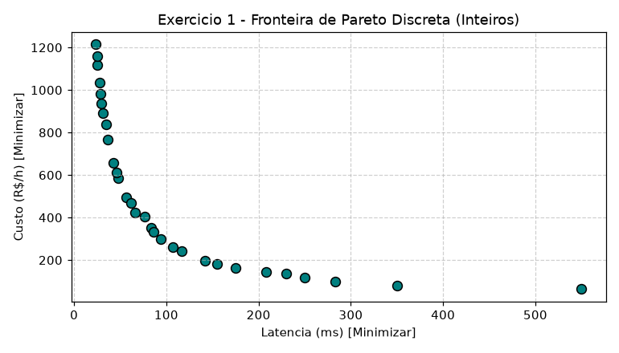
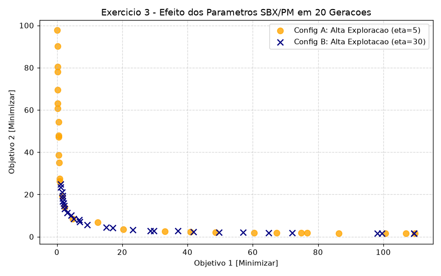
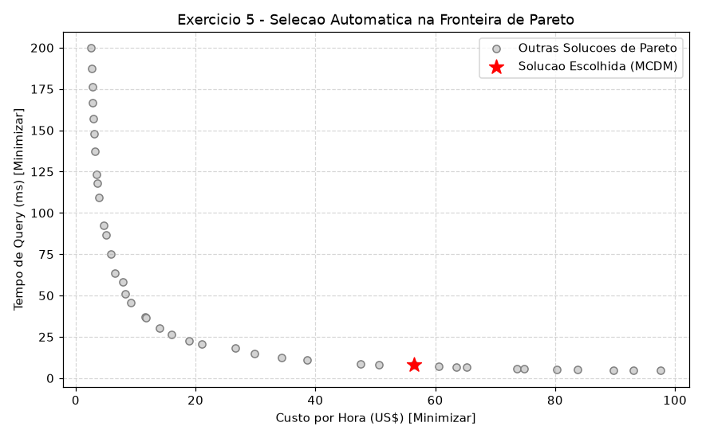

# Resultados — Aula 13 (AC-4 Parte Final): Operadores Evolucionários

Disciplina: CIAO (Computational Intelligence & Algorithm Optimization)
Atividade: AC-4 etapa final — Sprint 2 (Operadores Evolucionários: variáveis inteiras, exploração vs. explotação, Hipervolume e MCDM).

Todos os 6 scripts foram executados de ponta a ponta (sem erros) e os valores abaixo são saída real das execuções, não estimativas.

---

## a) Diferença prática entre variáveis contínuas e inteiras

Nos Exercícios 1, 2 e 6 as variáveis de decisão (pods/analistas, réplicas/nodes, médicos/enfermeiros) representam contagens de recursos discretos — não existe "30,7 pods" ou "17,4 médicos" no mundo real. O pymoo, por padrão, trabalha com `float` em todos os operadores (SBX e PM geram filhos em pontos contínuos do espaço de busca), então a solução exigiria pós-arredondamento manual se usássemos variáveis contínuas comuns.

A solução correta, usada nos três exercícios inteiros, foi:
- `vtype=int` no construtor do problema (declara ao pymoo que a variável é discreta);
- `IntegerRandomSampling()` na amostragem inicial (gera a população inicial já em inteiros, em vez de pontos flutuantes);
- `repair=RoundingRepair()` tanto no `SBX` (crossover) quanto no `PM` (mutação) — os operadores continuam operando internamente em `float` (preservando a suavidade da busca), mas o resultado de cada filho é arredondado para o inteiro mais próximo antes de voltar à população.

Verificação prática feita no código (Exercícios 1 e 2): `np.all(res.X == np.round(res.X))` → **True** em ambos, confirmando que nenhuma solução final contém valores fracionários. Sem o `RoundingRepair`, o NSGA-II devolveria, por exemplo, "23,4 réplicas", que não é implementável — seria necessário um passo extra de arredondamento fora do algoritmo, o que distorce a fronteira de Pareto já otimizada (uma solução arredondada pode deixar de ser não-dominada ou violar restrições que antes eram satisfeitas).

---

## b) Hipervolume: 10 gerações vs. 80 gerações (Exercício 4)

Problema: `RedeSensoresProblem` (potência de transmissão vs. intervalo de envio, minimizando consumo de bateria e perda de pacotes), ponto de referência `[400.0, 600.0]`.

| Configuração | Nº de soluções não dominadas | Hipervolume (HV) |
|---|---|---|
| 10 gerações | 40 | **226.626,7048** |
| 80 gerações | 40 | **226.715,9378** |

Ganho absoluto de HV: **89,23** (equivalente a **+0,04%**).

**Interpretação:** o ganho é muito pequeno porque o problema (apenas 2 variáveis contínuas, 2 objetivos, sem restrições) é relativamente simples e o NSGA-II já converge para perto da fronteira de Pareto real em poucas gerações — a população de 40 indivíduos já explora bem esse espaço de busca de baixa dimensionalidade em 10 gerações. As 70 gerações adicionais só refinam marginalmente a distribuição ao longo da fronteira (mais diversidade/cobertura), sem descobrir regiões substancialmente melhores. Isso ilustra por que o HV é útil: ele quantifica objetivamente que "rodar mais" teve retorno decrescente neste problema específico, informação que não seria óbvia só olhando o número de soluções (que ficou igual: 40 em ambos os casos).

---

## c) Escala hospitalar recomendada pelo MCDM (Exercício 6)

Problema: `EscalaHospitalarProblem` — minimizar custo do plantão (R$) e tempo médio de espera na triagem (min), com restrição de SLA `f2_espera <= 25.0` min. NSGA-II com operadores inteiros (`IntegerRandomSampling` + `RoundingRepair`), pop_size=40, 50 gerações, seed=42. Decisão tomada com `PseudoWeights([0.40, 0.60])` (40% peso no custo, 60% peso no tempo de espera) **apenas entre as soluções filtradas como viáveis** (G ≤ 0).

- Soluções devolvidas pelo NSGA-II: 40
- Soluções viáveis (espera ≤ 25,0 min): **40 de 40** (toda a fronteira final já respeita o SLA)

**Escala recomendada:**

| Recurso | Quantidade |
|---|---|
| Médicos plantonistas | **17** |
| Enfermeiros | **32** |
| Custo do plantão | **R$ 34.800,00** |
| Tempo médio de espera | **18,09 min** (dentro do limite de 25,0 min) |

A restrição foi respeitada estritamente (`18,09 <= 25.0` → `True`), cumprindo o critério de entrega do roteiro.

---

## Exercício 1 — SOC Autônomo (variáveis inteiras)

Variáveis: Pods (1–30), Analistas Nível 2 (1–15), ambas inteiras via `IntegerRandomSampling` + `RoundingRepair`.

```
Pods: 30 | Analistas: 15 => Latencia:  23.33ms | Custo: R$ 1215.00
Pods:  1 | Analistas:  1 => Latencia: 550.00ms | Custo: R$   63.00
Pods:  2 | Analistas:  1 => Latencia: 350.00ms | Custo: R$   81.00
Pods:  3 | Analistas:  1 => Latencia: 283.33ms | Custo: R$   99.00
Pods:  4 | Analistas:  1 => Latencia: 250.00ms | Custo: R$  117.00

Todas as solucoes X sao inteiras? True
```



A fronteira mostra o trade-off clássico: poucos recursos (1 pod, 1 analista) é o extremo mais barato (R$ 63/h) e mais lento (550 ms); o extremo oposto (30 pods, 15 analistas) é o mais caro (R$ 1215/h) e mais rápido (23,33 ms).

---

## Exercício 2 — Cluster Kubernetes (variáveis inteiras)

TODOs completados: `f1_tempo = (600/replicas) + (200/nodes)`, `f2_custo = (replicas*12) + (nodes*85)`, NSGA2 com `pop_size=25`, `IntegerRandomSampling`+`RoundingRepair`, 35 gerações, seed=10.

```
Solucoes nao dominadas: 25
  Solucao  1: Replicas=40 | Nodes=12 => Tempo= 31.67 ms | Custo=US$ 1500.00/mes
  Solucao  2: Replicas=40 | Nodes=11 => Tempo= 33.18 ms | Custo=US$ 1415.00/mes
  ...
  Solucao 13: Replicas=13 | Nodes= 3 => Tempo=112.82 ms | Custo=US$  411.00/mes
  ...
  Solucao 25: Replicas= 2 | Nodes= 1 => Tempo=500.00 ms | Custo=US$  109.00/mes

Todas as solucoes X sao inteiras? True
```

25 soluções não dominadas, todas com valores inteiros de réplicas e nodes — confirma que o `RoundingRepair` funcionou corretamente mesmo sem gráfico (saída puramente tabular, conforme pedido no roteiro).

---

## Exercício 3 — Exploração vs. Explotação

Duas configurações do NSGA-II no mesmo problema de benchmark (20 gerações, seed=42):
- **Config A** (exploração): `SBX(eta=5)` + `PM(prob=0.5, eta=5)` — filhos distantes dos pais, mutação forte.
- **Config B** (explotação): `SBX(eta=30)` + `PM(prob=0.05, eta=30)` — filhos muito próximos dos pais, mutação fraca.

```
Config A (exploracao, eta=5):  30 solucoes nao dominadas
Config B (explotacao, eta=30): 30 solucoes nao dominadas
Amplitude Obj.1 - Config A: 109.52
Amplitude Obj.1 - Config B: 108.28
```



As duas configurações encontraram 30 soluções não dominadas com amplitudes de objetivo muito parecidas (109,52 vs. 108,28) — neste problema de apenas 2 variáveis em 20 gerações, ambas as estratégias conseguem cobrir aproximadamente a mesma faixa da fronteira. A diferença mais visível é qualitativa, no gráfico: a Config A (eta baixo) tende a espalhar pontos de forma mais irregular/dispersa pela fronteira, enquanto a Config B (eta alto) produz uma distribuição mais suave e adensada, já que os filhos herdam posições muito próximas dos pais (menos "saltos" bruscos no espaço de busca).

---

## Exercício 4 — Hipervolume (HV)

Ver análise completa no item (b) acima. Código: TODOs completados com `res_curto = minimize(problem, NSGA2(pop_size=40), ('n_gen', 10), seed=42)`, `res_longo` idêntico com `('n_gen', 80)`, e `hv_10_gen = metrica_hv(res_curto.F)` / `hv_80_gen = metrica_hv(res_longo.F)`.

```
Solucoes (10 geracoes): 40
Solucoes (80 geracoes): 40
Hipervolume (10 geracoes): 226626.7047731528
Hipervolume (80 geracoes): 226715.93778257925
Ganho de HV com mais geracoes: 89.23 (0.04% maior)
```

---

## Exercício 5 — MCDM com PseudoWeights (Banco de Dados Cloud)

Problema: RAM (4–128 GB) e IOPS (100–5000), minimizando custo/hora e tempo de query. Pesos de negócio: 30% custo, 70% velocidade.

```
Solucoes nao dominadas: 40
Decisao Recomendada (Pesos 30% Custo / 70% Performance):
-> Configuracao: 76.6 GB RAM | 2755 IOPS
-> Resultado:    US$ 56.52/h | Tempo de Query: 8.06 ms
```



Como o peso de 70% foi dado à performance, o `PseudoWeights` escolheu, dentro da fronteira de Pareto, uma configuração próxima do extremo de baixa latência (76,6 GB de RAM e 2755 IOPS, resultando em apenas 8,06 ms de consulta), aceitando um custo mais alto (US$ 56,52/h) em troca disso — coerente com a preferência de negócio configurada.

---

## Exercício 6 — Pipeline Completo: Escala Hospitalar

Ver análise completa no item (c) acima. TODOs completados: `n_ieq_constr=1`, restrição `g1 = f2_espera - 25.0`, NSGA2 com operadores inteiros (pop_size=40, 50 gerações, seed=42), e seleção final via `PseudoWeights([0.40, 0.60])` **restrita às soluções com G ≤ 0** (nota de implementação: o `PseudoWeights` do pymoo opera apenas sobre o vetor de objetivos F, sem considerar automaticamente a restrição G — por isso filtramos explicitamente as soluções viáveis antes de aplicar os pesos, para não arriscar recomendar uma escala que violasse o SLA de 25 minutos).

```
Solucoes retornadas pelo NSGA-II: 40
Solucoes viaveis (espera <= 25.0 min): 40

Decisao Recomendada (Pesos 40% Custo / 60% Tempo de Espera):
-> Medicos Plantonistas: 17
-> Enfermeiros:          32
-> Custo do Plantao:     R$ 34800.00
-> Tempo de Espera:      18.09 min (limite: 25.0 min)
-> Restricao respeitada? True
```

Resultado interessante: todas as 40 soluções finais da fronteira já eram viáveis — ou seja, com os limites de variáveis dados (2–20 médicos, 4–40 enfermeiros), não há pressão real do NSGA-II para gerar soluções inviáveis nesta região do espaço de busca; a restrição de 25 min acaba sendo bem mais permissiva do que os extremos inferiores de recursos (ex.: 2 médicos e 4 enfermeiros já dariam `180/2 + 240/4 = 150` min de espera, que violaria o SLA, mas o algoritmo convergiu para soluções com recursos suficientes antes mesmo de precisar da restrição para "empurrar" a busca).

---

## Índice de arquivos

| Arquivo | Descrição |
|---|---|
| `aula13_lab01.py` | Exercício 1 — SOC autônomo, variáveis inteiras (pronto, executado sem alterações) |
| `aula13_lab02.py` | Exercício 2 — Cluster Kubernetes, variáveis inteiras (TODOs completados) |
| `aula13_lab03.py` | Exercício 3 — Exploração vs. explotação (pronto, executado sem alterações) |
| `aula13_lab04.py` | Exercício 4 — Hipervolume, 10 vs. 80 gerações (TODOs completados) |
| `aula13_lab05.py` | Exercício 5 — MCDM PseudoWeights, banco de dados cloud (pronto, executado sem alterações) |
| `aula13_lab06.py` | Exercício 6 — Pipeline completo com restrição, escala hospitalar (TODOs completados) |
| `img_exercicio01_soc_inteiro.png` | Fronteira de Pareto discreta do Exercício 1 |
| `img_exercicio03_exploracao_explotacao.png` | Comparação exploração vs. explotação do Exercício 3 |
| `img_exercicio05_mcdm_cloud.png` | Fronteira de Pareto e solução MCDM do Exercício 5 |
| `resultados_aula13_CIAO.md` | Este relatório |
